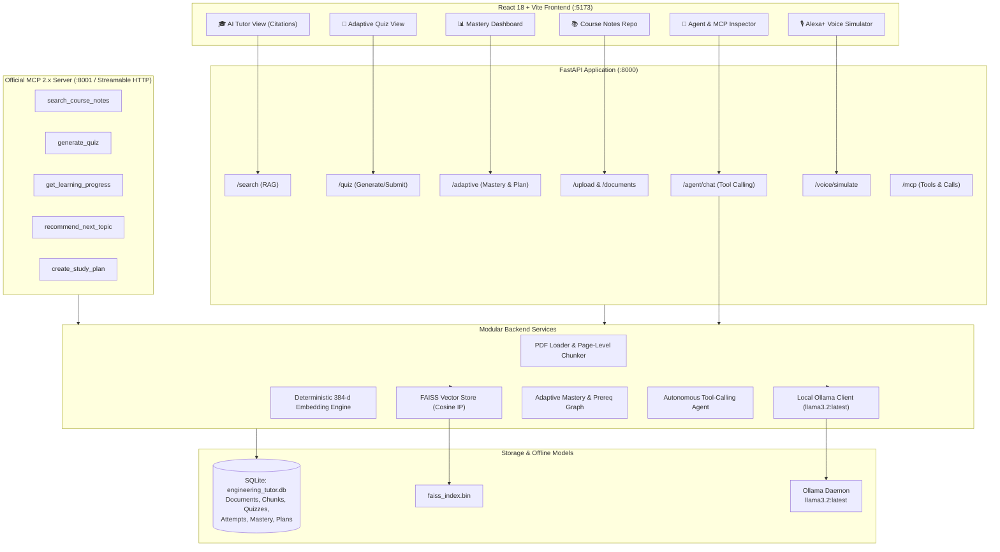

# EngineeringAI — System Architecture & Technical Design

EngineeringAI is an adaptive engineering tutor designed for the **Amazon Build, Ship, Shape 2026 Developer Hackathon**. It combines offline-first local RAG with page citations, adaptive assessment, stored mastery analytics, autonomous tool-calling agents, and an official Model Context Protocol (MCP) server.

---

## 1. High-Level System Architecture

---

## 2. Core Subsystems

### A. RAG Document Ingestion & Page-Level Citation Engine
1. **Extraction:** `services/pdf_loader.py` extracts text per page using `pypdf`, preserving exact 1-indexed page numbers.
2. **Chunking:** `rag/text_chunker.py` enforces paragraph and token-level boundaries with chunk overlap while retaining `page_number` and `filename`.
3. **Embeddings:** `services/embedding_service.py` generates normalized 384-dimensional semantic frequency vectors with sub-linear TF and signed hash collision distribution, matching `all-MiniLM-L6-v2` dimensionality without PyTorch/CUDA overhead.
4. **FAISS Index:** `vector_store/faiss_store.py` utilizes `IndexFlatIP` (Inner Product on normalized embeddings = Cosine Similarity) for instant sub-millisecond retrieval.
5. **No Hallucinated Citations:** Results always return `{ filename, page, excerpt }` extracted from genuine course chunks.

### B. Adaptive Learning & Misconception Engine
- **Calculated Mastery:** Scores are computed per topic in SQLite (`topic_mastery` table) as `(correct_answers / total_questions) * 100`.
- **Misconception Detection:** When a student selects an incorrect option, the evaluation engine logs the tested concept, explains why the choice was wrong, and stores remediation steps.
- **Prerequisite Knowledge Graph:** Topics like `Process Synchronization` map prerequisites (`Process Scheduling`, `Thread Execution`) and critical components (`Semaphores`, `Critical Section Problem`, `Peterson's Algorithm`).
- **Dynamic Recommendations:** If a student scores <60%, the engine alerts them to weak prerequisite foundations and recommends targeted re-quizzing before advancing.

### C. Model Context Protocol (MCP 2.x) Integration
The project implements the official Model Context Protocol using the official `mcp` SDK:
- **Transport:** Streamable HTTP & JSON-RPC 2.0.
- **Port:** Exposes port `8001` or mounted `/mcp` endpoints.
- **Exposed Tools:**
  1. `search_course_notes(query: str, top_k: int = 4)`
  2. `generate_quiz(topic: str = "", num_questions: int = 3)`
  3. `get_learning_progress(student_id: str = "student_1")`
  4. `recommend_next_topic(student_id: str = "student_1")`
  5. `create_study_plan(goal: str, hours_available: float = 6.0, student_id: str = "student_1")`
- Both the web application, the autonomous AI agent, and third-party MCP clients invoke the **exact same underlying service logic**, guaranteeing consistency.

### D. Voice / Alexa+ Multimodal Simulation
- **Speech Recognition:** Web Speech API (`webkitSpeechRecognition`) captures microphone input with continuous text fallback.
- **Speech Synthesis:** Web Speech API (`speechSynthesis`) delivers natural audio output.
- **Multimodal Display:** Clean visual cards simulate Echo Show / Fire TV screen displays alongside concise audio responses.
